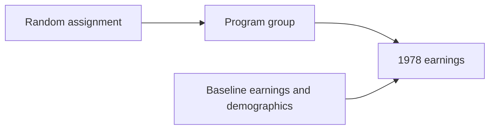

# Did access to supported work increase earnings?

Public worked example for the [real-data track](README.md).

## Research question

How much did assignment to the National Supported Work program change 1978 earnings for the men in Dehejia and Wahba's experimental sample with 1974 earnings data, the RE74 subset?

## Study design and data source

Eligible applicants were randomized to a program or control group. The RE74 subset uses enrollment timing and employment history before randomization. Stack the 185 treatment rows and 260 experimental control rows, keeping zero earnings. Each row represents one participant. The archived CPS and PSID files provide separate observational comparison groups. [Article](https://doi.org/10.1080/01621459.1999.10473858) · [Data archive](https://users.nber.org/~rdehejia/data/.nswdata2.html)

The linked files are whitespace-delimited with no header. Use these names and roles in file order.

| Position | Analysis name | Meaning |
| --- | --- | --- |
| 1 | `treat` | Study assignment, 1 for program and 0 for experimental control |
| 2–7 | `age`, `educ`, `black`, `hispanic`, `married`, `nodegree` | Baseline demographic and education variables |
| 8–9 | `re74`, `re75` | Annual earnings before treatment |
| 10 | `re78` | Annual earnings in 1978, the outcome |

## DAG and identification



The program group $A$ is observed in `treat` and the outcome $Y$ in `re78`. The baseline nodes use columns 2–9. Within the pretreatment-defined subset, randomization supports the difference in group means as an estimator of the assignment effect. This interpretation assumes consistency and no interference between participants.

## Target estimand and reference estimate

The target is the average effect of assignment over the $445$ people in this experimental sample, in 1982 U.S. dollars.

$$
\tau=\frac{1}{445}\sum_{i=1}^{445}\bigl(Y_i(1)-Y_i(0)\bigr).
$$

The unadjusted difference in mean earnings is **1,794.34 dollars**. The pooled-variance standard error is **632.85 dollars**, matching the rounded report of 1,794 (SE 633) in Table 2. The normal-approximation 95% interval calculated from the files is **[553.95, 3,034.74] dollars**. The randomized comparison is a reference estimate with sampling uncertainty. [Paper, Table 2, panel B, column 1](https://users.nber.org/~rdehejia/papers/dehejia_wahba_jasa.pdf)

## Benchmark comparison

Run an ATE-capable tabular foundation model and a conventional covariate-adjusted estimator on the same sample. Report each point estimate and interval beside the randomized reference. Compare changes in the estimate and interval length from adjustment. Repeated-sampling coverage requires repeated experiments.

## Materials and access

The author's data archive provides public access. Check its terms before redistributing the files. The following base R code reads the original experimental arms and reproduces the reference. [Data and codebook](https://users.nber.org/~rdehejia/data/.nswdata2.html) · [Treatment file](https://users.nber.org/~rdehejia/data/nswre74_treated.txt) · [Control file](https://users.nber.org/~rdehejia/data/nswre74_control.txt)

```r
base <- "https://users.nber.org/~rdehejia/data/nswre74_"
treated <- read.table(paste0(base, "treated.txt"))[[10]]
control <- read.table(paste0(base, "control.txt"))[[10]]
n1 <- length(treated)
n0 <- length(control)
effect <- mean(treated) - mean(control)
pooled_var <- ((n1 - 1) * var(treated) + (n0 - 1) * var(control)) / (n1 + n0 - 2)
se <- sqrt(pooled_var * (1 / n1 + 1 / n0))
round(c(estimate = effect, se = se, lower = effect - 1.96 * se,
        upper = effect + 1.96 * se), 2)
```
